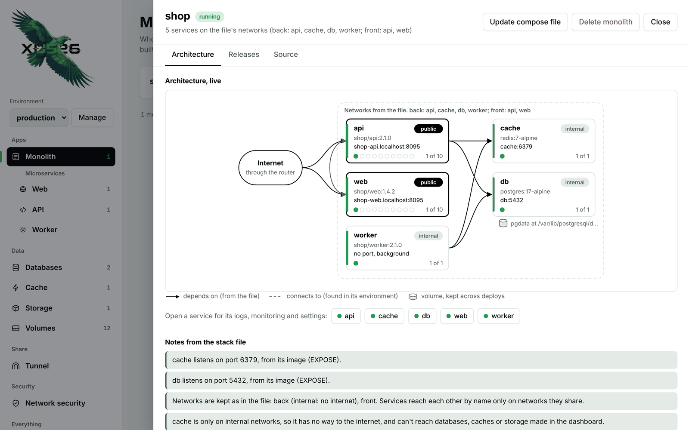
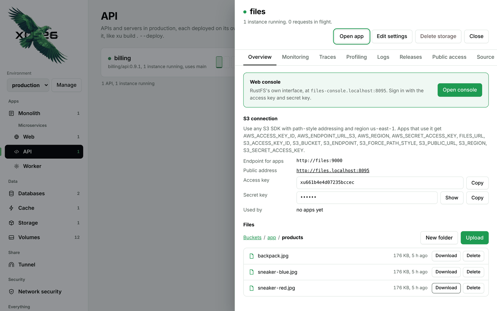
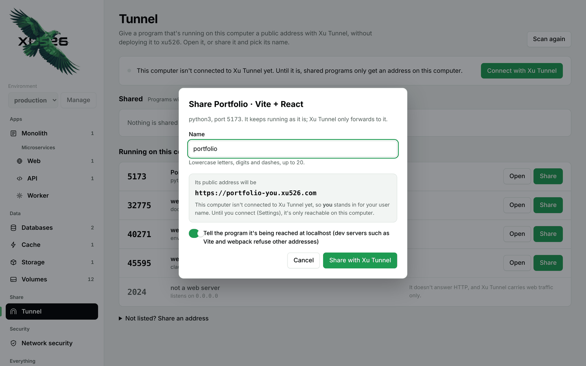
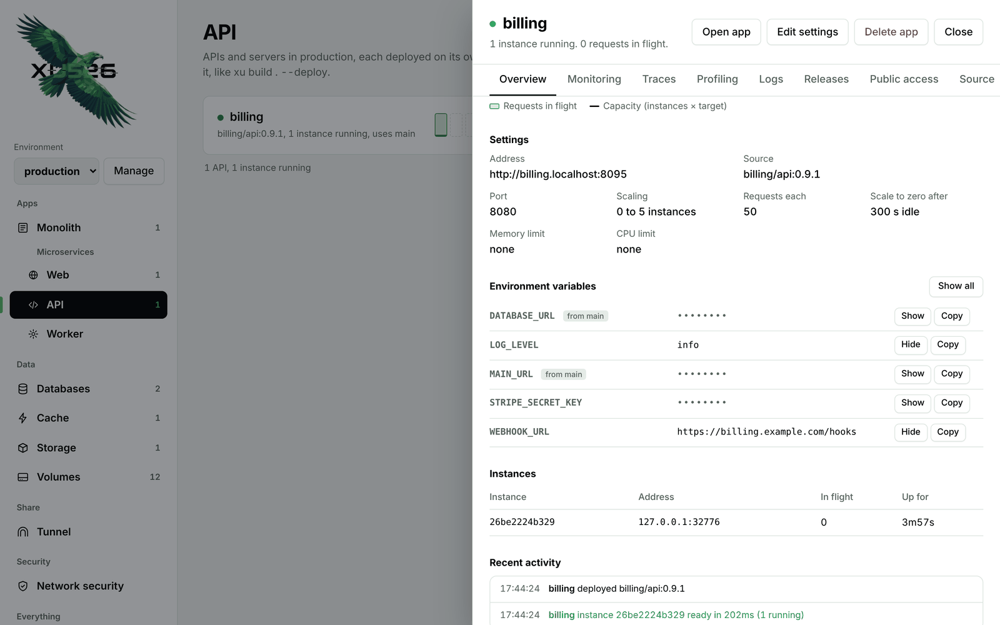
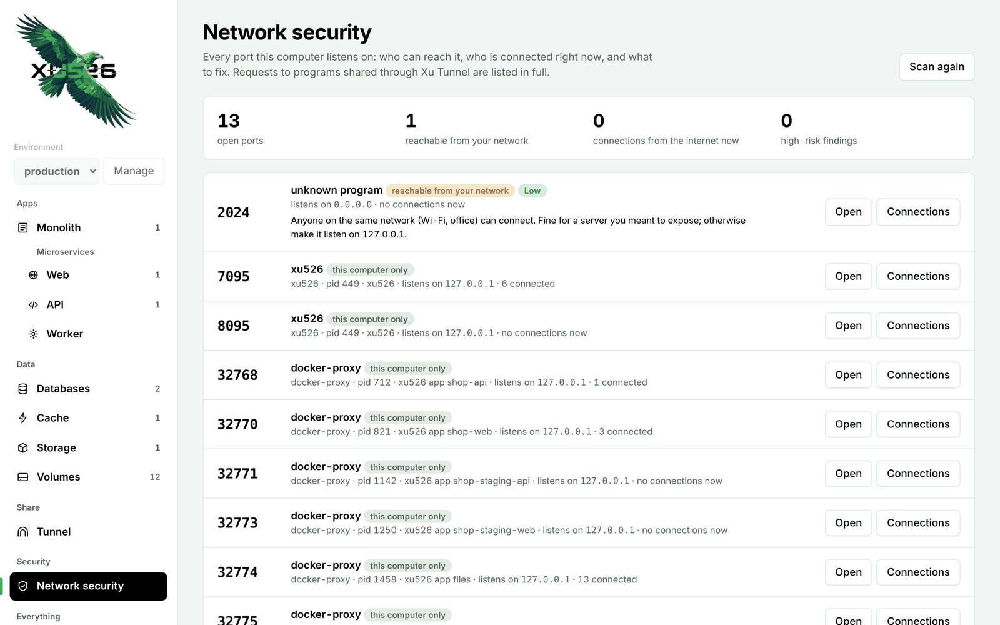

<p align="center"></p>

<h1 align="center">xu526</h1>

<p align="center"><b>Your own PaaS, on your own computer or server.</b><br>
Deploy a folder or a docker-compose.yml, scale to zero safely, add databases and S3 storage in a click,<br>
and share anything over HTTPS with Xu Tunnel.</p>

<p align="center">Docker or Podman · Linux, macOS, Windows · Written in Go, almost no dependencies</p>



## What it does

- **Monoliths from one compose file.** xu526 reads your existing `docker-compose.yml` (networks, `depends_on`, `.env`, `env_file`, health checks, profiles) and builds services with `docker compose build`. It then runs them and draws the live architecture: what's public, what talks to what, and which networks each service shares.
- **Microservices:** web apps, APIs and background workers, each deployed from a folder (`xu build . --deploy name`) or an image.
- **Connect GitHub:** sign in on GitHub and come back, pick a repository, and deploy it as a monolith or a microservice. xu526 checks the branch every 30 seconds and shows each new commit with a Deploy button, or deploys it at once if you turn that on. It only asks GitHub to read code, and works behind a home router (no webhooks).
- **Scale to zero, without failed cold starts.** Idle apps stop. When a request wakes one, xu526 first starts what it depends on (backend, database) and waits until it's healthy. Dependencies stay up while anything that needs them runs.
- **Databases and caches:** PostgreSQL, MySQL, MongoDB and Redis in a couple of clicks. Apps that link to one get their connection settings automatically.
- **Object storage:** four open-source S3 stores (RustFS, Silo, Garage, SeaweedFS), each with its own web console and a file browser in the dashboard.
- **Environments:** production, staging and more, each an isolated copy with its own variables and secrets. Every service lists its environment variables, hidden until you reveal them.
- **Xu Tunnel:** give any program on your computer a public HTTPS address, even programs you didn't deploy with xu526. It needs no port forwarding: your computer opens one outbound connection, and visitors come through it.
- **Network security:** every open port on your machine, who can reach it, who's connected right now, and warnings for risky exposure.
- **Day-to-day tools:** releases and rollback, logs, metrics and traces, volumes, and a CLI (`xu`) for everything the dashboard does.

| | |
|---|---|
|  |  |
|  |  |

## Install

Download the latest release for your system from the [Releases](../../releases) page. It contains ready-built programs, so you don't need Go.

**Linux and WSL2**
```bash
unzip xu526-1.0.0.zip && cd xu526-1.0.0
sudo ./install-linux.sh
```

**macOS** (13 or later, Apple Silicon or Intel; run it as yourself, without sudo)
```bash
unzip xu526-1.0.0.zip && cd xu526-1.0.0
./install-macos.sh
```
It sets up Colima and the Docker CLI for you; Homebrew isn't needed.

**Windows:** unzip `xu526-1.0.0-windows.zip` and double-click `install.cmd`. It installs Podman if you don't have Docker Desktop.

Then open the dashboard at **http://localhost:7070**.

**Or install straight from this repository.** The installers build xu526 from the source when there's no ready-built program, which needs Go 1.24 or later (on Linux it's installed for you if it's missing):
```bash
git clone https://github.com/Tomiphred/xu526.git && cd xu526
sudo ./scripts/install-linux.sh     # Linux and WSL2
./scripts/install-macos.sh          # macOS, without sudo
```
On Windows, install Go (`winget install GoLang.Go`), then double-click `scripts\install.cmd`.

## Quick start

```bash
# a whole project from its compose file
xu stack deploy shop -f docker-compose.yml

# one app from a folder (no Dockerfile needed for Node, Python, Go and static sites)
xu build . --deploy myapp

# share it on the internet over HTTPS
xu tunnel login
xu share myapp
```

## Build from source

Requires Go 1.24 or later.
```bash
go build -o xu526 ./cmd/xu526
./scripts/package.sh        # release zips in dist/
```

## Documentation

The full guide covers stacks, environments, databases, storage, the tunnel, networks, scaling, monitoring and more: **[docs/guide.md](docs/guide.md)**.

## Status

xu526 is in active development. The control API has no authentication, so it listens only on `127.0.0.1`. Run it on machines you control, and expect changes between versions.

Feedback, bug reports and contributions are welcome: please open an issue.

## License

[MIT](LICENSE)
